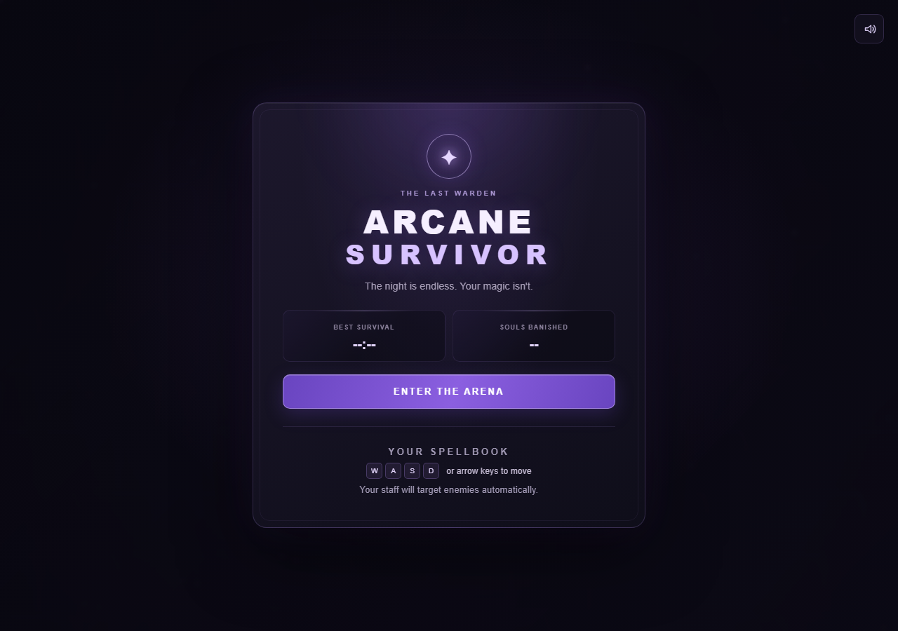
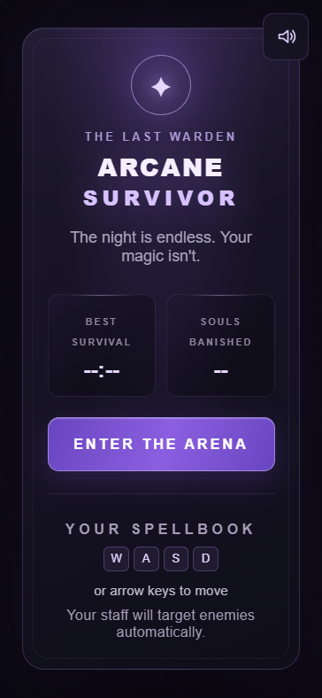
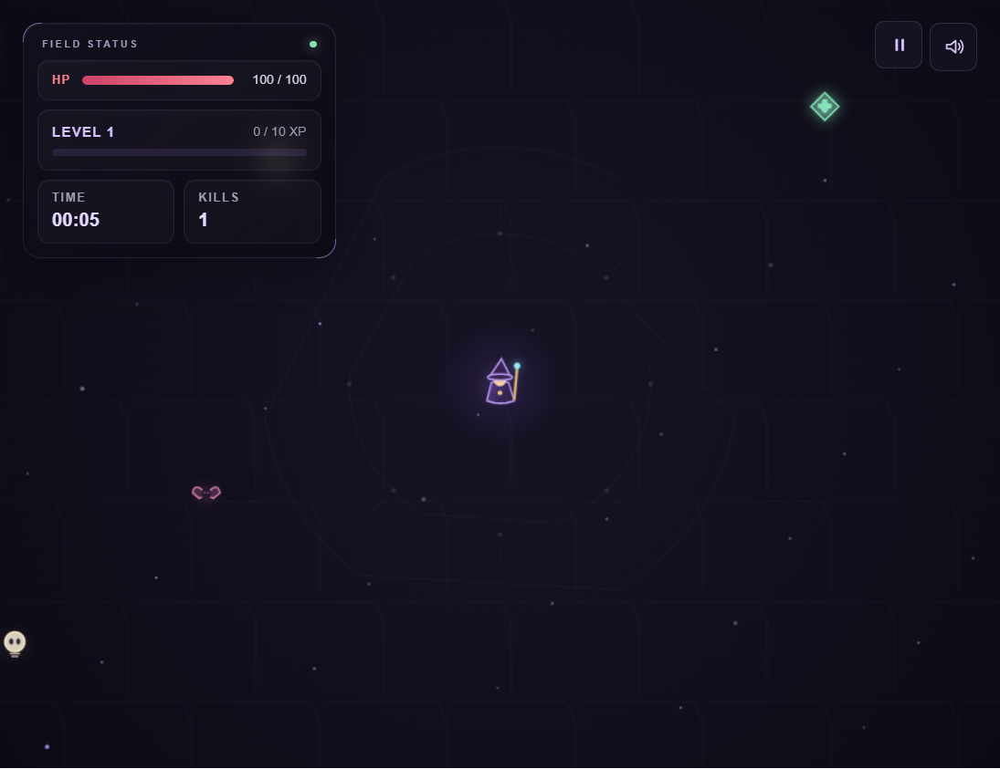

# Arcane Survivor

Survive the endless night in this Vampire Survivors-style browser game. Choose
your character, move through the arena while your staff automatically targets
nearby enemies, collect XP, and choose upgrades to grow stronger.

## Play

The game uses HTML, CSS, JavaScript ES modules, and the Canvas 2D API. It has
no build step, package installation, external libraries, or external game
assets.

1. Clone or download this repository.
2. From the project folder, start a local static server:

   ```sh
   python -m http.server 8000
   ```

3. Open [http://localhost:8000](http://localhost:8000) in a modern browser.

The game needs to be served from a local server because browsers restrict
JavaScript modules opened directly from the file system.

## Screenshots

### Menu





### Gameplay



## Controls

| Input | Action |
| --- | --- |
| WASD or arrow keys | Move |
| Esc | Pause or resume |
| 1, 2, or 3 | Choose a level-up upgrade |
| Enter | Start from the menu |
| R | Return to the menu after game over |
| Speaker button | Toggle sound |
| On-screen D-pad (touch devices) | Hold a direction to move; hold two for diagonals |
| Character cards in the menu | Choose The Warden or The Wispkeeper |

The menu and HUD adapt to mobile screens. On touch-capable devices, use the
on-screen D-pad to move; desktop keyboards continue to work as usual.

## Features

- Three enemy types and timed boss encounters
- Two playable characters: The Warden and The Wispkeeper, who begins with an orb
- Automatic targeting and firing
- XP collection, level-ups, and stackable upgrades
- Rare power-ups, including healing, an area nuke, and temporary buffs
- Boss health bar, combat feedback, generated sound effects, and pause/resume
- Best survival time and kill records saved in browser storage
- Responsive menu and HUD with original Canvas-drawn characters and arena art

## Project structure

```text
index.html
style.css
js/
  audio.js       Generated sound effects and mute persistence
  config.js      Gameplay, upgrade, power-up, and effect tuning
  effects.js     Combat feedback, particles, and pulse attack
  enemies.js     Enemy types, spawning, and boss timing
  input.js       Keyboard and touch movement input
  main.js        Game state, update loop, and Canvas rendering
  pickups.js     XP gems and power-up drops
  player.js      Player movement, regeneration, and auto-fire targeting
  projectiles.js Projectile and orbiting orb behavior
  ui.js          Menu, HUD, level-up, and record handling
  upgrades.js    Upgrade definitions and selection
  utils.js       Shared math and collision helpers
```

Gameplay tuning belongs in `js/config.js`. The project is intentionally
dependency-free and can be run with any static file server.

## GitHub Pages

The repository includes a GitHub Actions workflow that deploys the static game
when changes are pushed to `main`. To enable it, open the repository's
**Settings → Pages** and set the build and deployment source to **GitHub
Actions**. You can also start a deployment manually from the **Actions** tab.

After the first successful deployment, GitHub Pages will show the public URL
in the Pages settings and the deployment workflow.

## Browser storage

The game stores best survival time, best kill count, and the mute preference
in `localStorage` on the current browser. Clearing site data resets these
records and settings.
